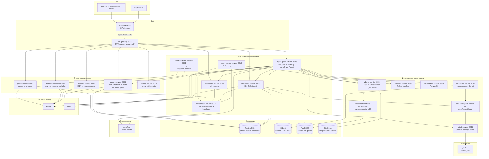
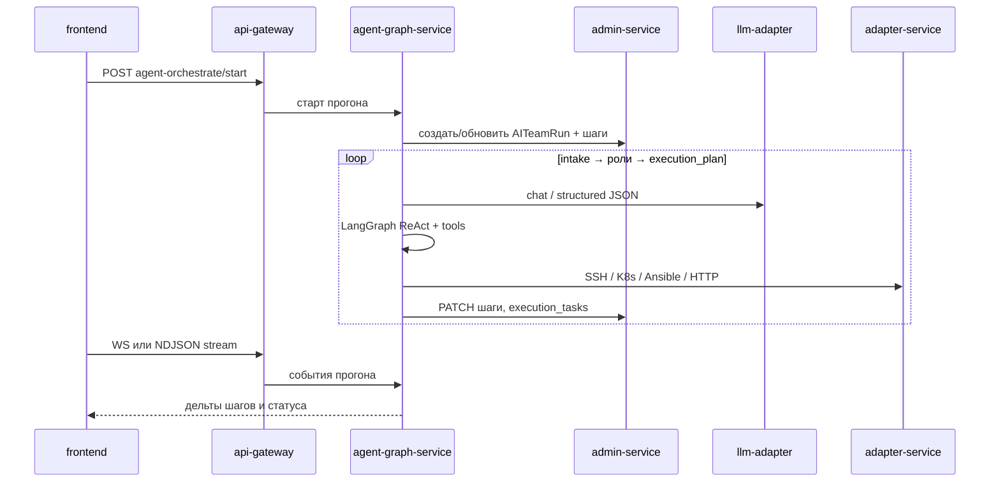

# Lambot Platform — архитектура (обзор)

Платформа заменяет IT-команду для основателя: проекты, планирование продукта, **AI-команда** (роли SA/PM/архитектор/DevOps/Backend/Frontend/QA), исполнение на инфраструктуре пользователя (SSH, K8s, Ansible), GitLab, wiki/документы и базы знаний.

Стек развёртывания по умолчанию: `Platform/docker-compose.yml` (микросервисы Python/FastAPI + SPA + Kafka + несколько PostgreSQL).

---

## Схема платформы (flowchart)



### Типовой сценарий: запрос в AI-команду



---

## Слои и принципы

| Слой | Назначение |
|------|------------|
| **Край** | Единая точка входа для браузера: статика UI + прокси `/api` на gateway (в т.ч. WebSocket). |
| **API Gateway** | Авторизация (JWT), tenant/project ACL, проксирование к внутренним сервисам. |
| **Домен** | Проекты, планирование, каталог, проекция админки, машина статусов проекта. |
| **AI-команда** | Многошаговый пайплайн ролей, LangGraph с tool calling, публикация задач на исполнение. |
| **Исполнение** | Безопасные адаптеры к SSH, Ansible, Git, браузеру, песочнице. |
| **Данные** | Изоляция: у каждого сервиса своя PostgreSQL; асинхронность через Kafka (outbox/inbox). |

---

## Компоненты

### Пользовательский интерфейс

| Компонент | Порт | Что делает |
|-----------|------|------------|
| **frontend** | 5173 → 80 | SPA (портал пользователя `#/portal`, superadmin `#/superadmin`). В prod nginx отдаёт статику и проксирует `/api` на gateway. |
| **api-gateway** | 8000 | Единый REST/WS API: проекты, planning, оркестрация AI-команды, adapter, admin, knowledge, browser logs и др. |

### Управление платформой и домен

| Компонент | Порт | Что делает |
|-----------|------|------------|
| **admin-service** | 8006 | Пользователи и роли, настройки LLM/агентов, **прогоны AI-команды** (runs/steps/execution_tasks), трекер (эпики/задачи), промпты ролей, внутренние API для agent-graph. |
| **project-service** | 8001 | Жизненный цикл проектов, тенанты, outbox событий в Kafka. |
| **planning-service** | 8002 | Прогон product planning (идея → структурированный план), вызов LLM. |
| **orchestrator-service** | 8003 | **Не путать с AI-orchestrate:** консьюмер Kafka, проекция **статуса проекта** (workflow платформы). |
| **catalog-service** | 8004 | Справочник стеков и blueprints для проектов. |
| **agent-bootstrap-service** | 8011 | Слушает события создания проекта → при необходимости автоматически запускает planning. |

### AI-команда и LLM

| Компонент | Порт | Что делает |
|-----------|------|------------|
| **agent-graph-service** | 8013 | Ядро **AI-команды**: intake (full/direct), шаги SA/PM/архитектор/планы/implementation/deploy/QA, `execution_plan` → задачи воркерам; LangGraph ReAct с platform tools; stream/WS событий. |
| **llm-adapter-service** | 8005 | Прокси к OpenAI-compatible API; настройки моделей из admin; трейсинг в Langfuse. |
| **agent-worker-service** | 8010 | Потребляет `platform.agent.tasks` из Kafka, выполняет задачи (через adapter/LLM), пишет результаты. |
| **documents-service** | 8015 | Wiki/документы проекта (architecture, guides), контекст для агентов. |
| **knowledge-service** | 8019 | Базы знаний (платформа + проект): загрузка файлов, ingest (Kafka), чанки в Qdrant, `search_knowledge` для агентов. |

Роли в пайплайне (упрощённо): **intake** → маршрут full/direct → **SA** (формальные артефакты, трекер) → **PM / architect / devops / backend / frontend** → **execution_plan** → **implementation / deploy / QA / pm_summary**. В режиме `direct` часть шагов пропускается, ответ одной роли через ReAct.

### Исполнение и DevTools

| Компонент | Порт | Что делает |
|-----------|------|------------|
| **adapter-service** | 8008 | SSH targets, выполнение команд, подтверждения, HTTP executor, ingest метрик агента; связь с Ansible и ClickHouse. |
| **ansible-orchestrator-service** | 8007 | Marketplace Ansible-ролей (шаблоны в S3/RustFS), запуск плейбуков по запросу adapter/агентов. |
| **sandbox-service** | 8012 | Ограниченное выполнение Python для агентов. |
| **browser-tool-service** | 8014 | Playwright-сессии: навигация, снимки UI, smoke веб-приложений. |
| **gitlab-service** | 8016 | Provision групп/репозиториев, токены, интеграция с GitLab CE (опционально). |
| **repo-workspace-service** | 8018 | Локальные git-workspace: clone, read/write, commit, push. |
| **code-index-service** | 8017 | Индексация кода из workspace, семантический поиск (Qdrant). |

### Инфраструктура данных

| Компонент | Назначение |
|-----------|------------|
| **Kafka** | События домена (`platform.events`), задачи агентов (`platform.agent.tasks`), ingest knowledge. Паттерны outbox/inbox в сервисах. |
| **Redis** | Кэш/координация в agent-graph (например, последний run проекта). |
| **PostgreSQL** | Отдельный инстанс на сервис: `project`, `planning`, `admin`, `orchestrator`, `adapter`, `documents`, `knowledge`, `gitlab`, `repo-workspace`, `code-index`. |
| **Qdrant** | Векторные коллекции: чанки knowledge-base и code-index. |
| **RustFS (S3)** | Объектное хранилище: Ansible-шаблоны, файлы knowledge-base. |
| **ClickHouse** | Хранение метрик и логов с агентов на серверах пользователя. |

### Наблюдаемость и опции

| Компонент | Назначение |
|-----------|------------|
| **Langfuse** (web, worker, postgres, redis, clickhouse, minio) | Трейсы LLM-вызовов (llm-adapter, agent-graph). |
| **gitlab-ce** (profile `gitlab`) | Локальный GitLab CE для разработки; **gitlab-service** ходит в него по API. |

---

## Два вида «оркестрации»

| Термин | Сервис | Смысл |
|--------|--------|--------|
| **Project orchestration** | `orchestrator-service` | Статусы жизненного цикла **проекта** по событиям Kafka. |
| **AI-team orchestration** | `agent-graph-service` + `admin-service` | Прогон **запроса пользователя** через роли команды, задачи исполнения, stream в UI. |

---

## Потоки данных (кратко)

1. **Создание проекта** → `project-service` → Kafka → `agent-bootstrap` / `orchestrator` / проекция в `admin`.
2. **Product planning** → UI → gateway → `planning-service` → LLM → результат в planning DB.
3. **AI-команда** → gateway → `agent-graph` ↔ `admin` (runs) ↔ tools → `adapter` / Git / docs / knowledge → Kafka tasks → `agent-worker`.
4. **Knowledge upload** → gateway → `knowledge-service` → S3 + Kafka ingest → Qdrant; агенты ищут через tool `search_knowledge`.
5. **Код** → `gitlab-service` + `repo-workspace` + `code-index` (clone → правки → push → поиск).

---

## Репозиторий

| Путь | Содержимое |
|------|------------|
| `Platform/backend` | Все микросервисы (`services/*`), общие контракты, тесты. |
| `Platform/frontend` | TypeScript SPA, nginx для prod. |
| `Platform/docs` | Тематические заметки (GitLab, knowledge, code-index). |
| `schema.md` | Упрощённая схема только пайплайна AI-команды. |

---

## Локальный запуск

```bash
cd Platform
docker compose up -d --build
```

- UI: http://localhost:5173  
- API: http://localhost:8000  
- Подробнее: `Platform/README.md`

Для тяжёлого GitLab CE: `docker compose --profile gitlab up -d`.
