# Lambot Platform — архитектура (обзор)

Платформа заменяет IT-команду для основателя: проекты, планирование продукта, **AI-команда** (роли SA/PM/архитектор/DevOps/Backend/Frontend/QA), исполнение на инфраструктуре пользователя (SSH, K8s, Ansible), GitLab, wiki/документы и базы знаний.

Стек развёртывания по умолчанию: `Platform/docker-compose.yml` (микросервисы Python/FastAPI + SPA + Kafka + несколько PostgreSQL).

---

## Архитектурная схема: агенты и компоненты (для презентации)

Ниже — схемы для слайдов и обсуждения с архитекторами: **виртуальная IT-команда (агенты)**, **движок оркестрации**, **платформенные сервисы** и **плоскость инструментов**.

### 1. Компоненты платформы и место агентов

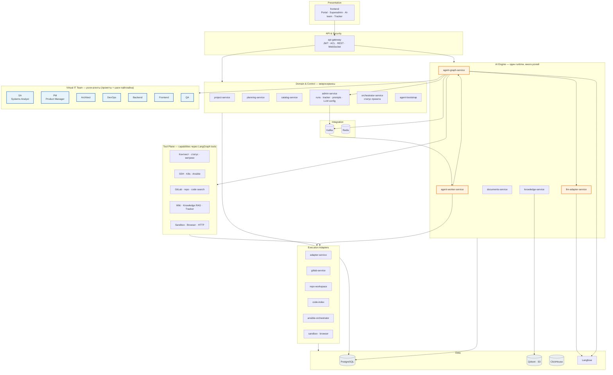

### 2. Мультиагентная команда: пайплайн и режимы

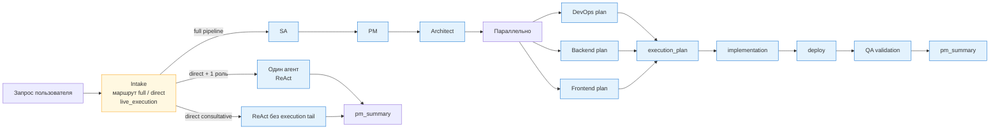

**Режимы intake (решение LLM, не keyword-эвристика):**

| Режим | Агенты | Исполнение |
|--------|--------|------------|
| `full` | SA → PM → Architect → планы → execution | DAG + worker tasks |
| `direct` + `live_execution: false` | Одна роль | ReAct, факты с сервера / консультация |
| `direct` + `live_execution: true` | Одна роль + execution tail | ReAct + execution_plan → deploy |

### 3. Агенты: зона ответственности и инструменты

| Агент | Шаги пайплайна | Зона | Типичные tools |
|--------|----------------|------|----------------|
| **SA** | `sa` | ТЗ, глоссарий, traceability, эпики/задачи в трекере | `upsert_project_document`, `tracker_create_*`, `tracker_list_items` |
| **PM** | `pm`, `pm_summary` | Scope, KPI, итог для стейкхолдера | контекст, wiki, `get_project_status` |
| **Architect** | `architect` | Стек, HLD, границы сервисов | wiki, контекст, peer consult |
| **DevOps** | `devops_plan`, `execution_plan`, `implementation`, `deploy` | CI/CD, SSH, Ansible, K8s | `ssh_run_command`, `ansible_run_template`, `kubernetes_query`, GitLab |
| **Backend** | `backend_plan` | API, сервисы, БД | `search_codebase`, `repo_*`, контекст |
| **Frontend** | `frontend_plan` | UI, веб, графики | `repo_write_commit_push`, `browser_session`, контекст |
| **QA** | `qa_validation` | Smoke, GO/NO_GO | `browser_session`, SSH, метрики |

Все роли на шагах с tools используют **один LangGraph ReAct runtime** (`agent-graph`) и **общий каталог platform tools** (политика `tool_policy` по проекту).

### 4. Runtime агента: ReAct + оркестратор


### 5. Три канала взаимодействия с агентами

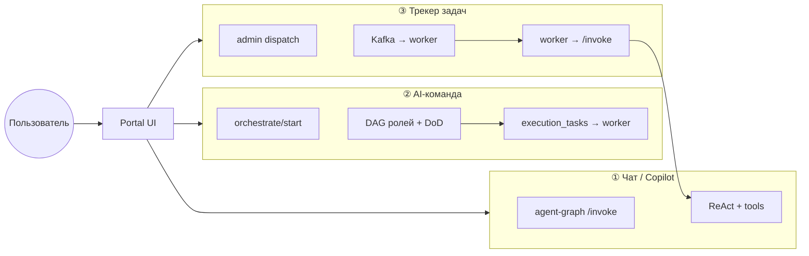

### 6. Плоскость инструментов (группы capabilities)

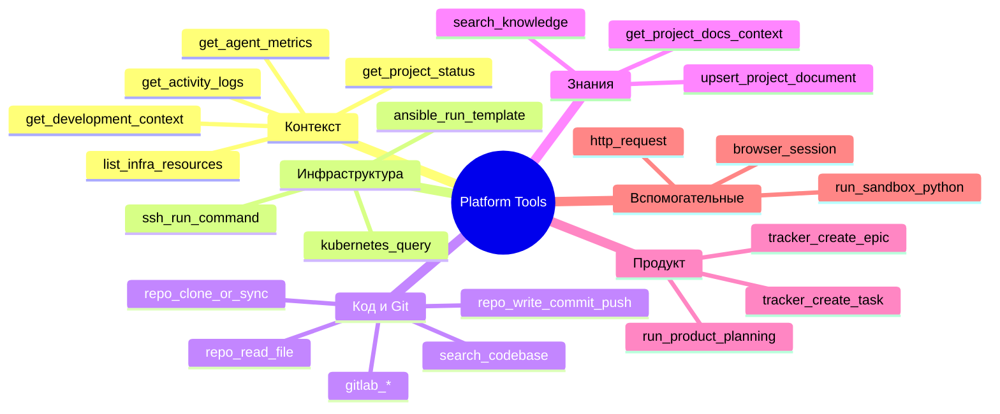

---

## Как общаются агенты между собой

Агенты **не ведут постоянный групповой чат** и **не вызывают друг друга как отдельные LangGraph-инстансы**. Связь идёт через **оркестратор** и **общее состояние прогона** (паттерн «blackboard»).

### Способы «общения»

| Способ | Когда | Как |
|--------|--------|-----|
| **1. Накопленный контекст** | Каждый следующий шаг пайплайна | В system prompt попадает `### PM`, `### Architect`, … — выводы всех завершённых шагов (`accumulated`) |
| **2. Peer queries** | Шаг вернул `peer_queries` в JSON | Оркестратор синхронно спрашивает «коллегу» (отдельный LLM-вызов с ролью peer) и дописывает ответ в `summary_md` |
| **3. Параллельные планы** | devops / backend / frontend одновременно | Стартуют с **одним снимком** `accumulated`; при ошибке retry — `debug_hint` с выводами уже сделавших коллег |
| **4. Артефакты** | SA, wiki, трекер | Документы wiki, эпики/задачи в трекере с `assignee_role` — **асинхронная** передача работы другой роли |
| **5. Execution tasks** | После `execution_plan` | Общий список задач в `AITeamRun.execution_tasks` — воркеры исполняют, статусы видят все шаги |
| **6. ReAct tools** | Внутри одного вызова `/invoke` | Один агент может вызвать `tracker_list_items`, `get_project_docs_context` — это доступ к **данным**, не диалог с другим агентом |

**Нет:** прямых message-passing между двумя ReAct-графами, shared memory между параллельными шагами в реальном времени, отдельного «менеджера агентов»-LLM.

### Схема обмена в AI-команде

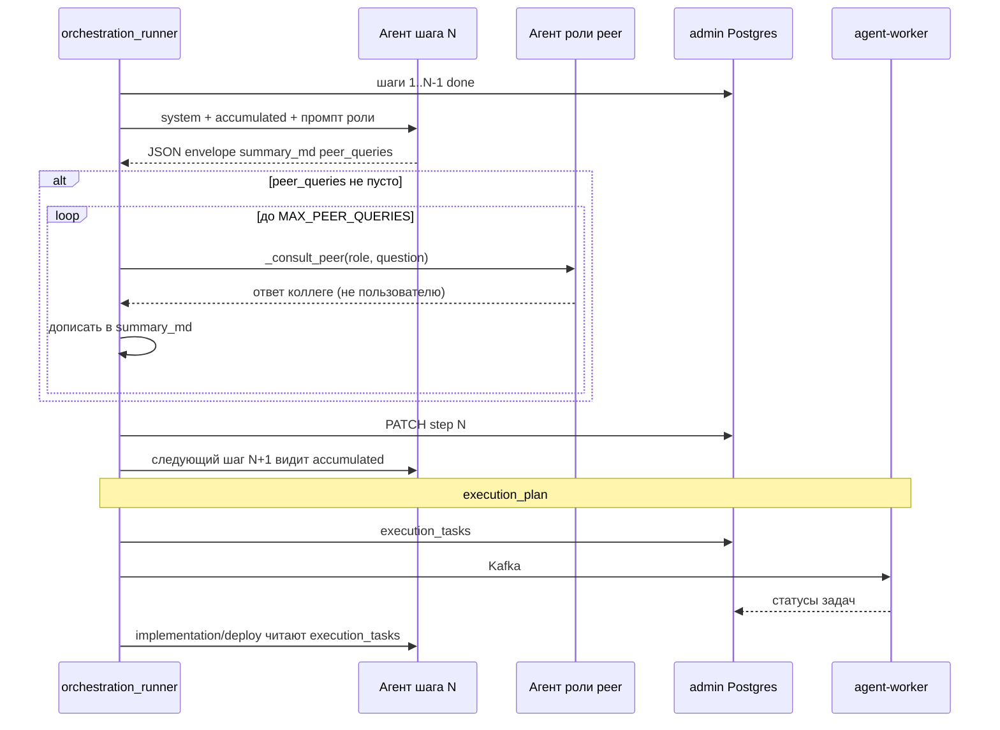

### Peer sync (деталь)

В JSON шага агент может указать:

```json
"peer_queries": [{"role": "backend", "question": "Какие эндпоинты уже есть в API?"}]
```

Оркестратор вызывает `_consult_peer`: отдельный chat с **промптом роли backend**, тем же **project context** и **накопленными шагами**, инструкцией «ответь коллеге, не пользователю». Ответ вставляется в блок «Синхронизация с командой (авто)» в итоге шага.

Роли для peer: `pm`, `architect`, `devops`, `backend`, `frontend` (не `qa` / `sa` в маппинге `PRIMARY_ROLE_TO_STEP`).

### Параллельные планы

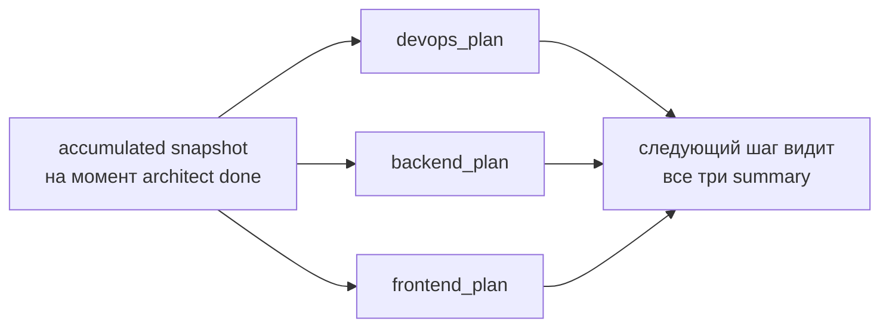

Пока планы идут параллельно, **друг о друге в процессе не узнают** — только после записи в `accumulated`.

### Трекер vs AI-команда

| Канал | Смысл |
|-------|--------|
| **AI-команда** | Один run, один поток шагов, общий `run_id` |
| **Трекер** | SA (или пользователь) создаёт задачи с `assignee_role`; исполнение — **отдельный** Kafka → worker → ReAct; связь с run только через `meta_json` / описание, не live-chat между агентами |

### С пользователем (не между агентами, но важно)

- `questions_for_user` + `pipeline_continue: false` → пауза run, ответ пользователя в `orchestrate/continue`.
- Подтверждение tool-calling («да, выполняй») → снимает gate, не peer-диалог.

---

## Функциональная схема платформы

Функциональный взгляд: **что делает платформа для бизнеса**, кто потребитель функции и **какие сквозные сценарии** связывают блоки (без привязки к портам и именам сервисов).

### F1. Карта функций (верхний уровень)

```mermaid
flowchart TB
  classDef gov fill:#fce4ec,stroke:#c2185b
  classDef prod fill:#e8eaf6,stroke:#3949ab
  classDef eng fill:#e0f2f1,stroke:#00695c
  classDef ops fill:#fff3e0,stroke:#e65100
  classDef know fill:#f3e5f5,stroke:#6a1b9a

  LP["Lambot Platform<br/>виртуальная IT-команда для основателя"]

  LP --> GOV["Управление платформой"]:::gov
  LP --> PROD["Продукт и проект"]:::prod
  LP --> ENG["Инженерия с AI-агентами"]:::eng
  LP --> OPS["Эксплуатация и инфраструктура"]:::ops
  LP --> KNOW["Знания и артефакты"]:::know

  GOV --> GOV1["Пользователи · роли · тенанты"]
  GOV --> GOV2["Настройки LLM и промптов агентов"]
  GOV --> GOV3["Политики tools · superadmin"]

  PROD --> PROD1["Создание проекта · каталог стеков"]
  PROD --> PROD2["Product planning IDEA → PLAN"]
  PROD --> PROD3["Статус жизненного цикла проекта"]

  ENG --> ENG1["Маршрутизация запроса intake"]
  ENG --> ENG2["Формальная спецификация SA"]
  ENG --> ENG3["Архитектура и планы ролей"]
  ENG --> ENG4["Реализация кода GitLab"]
  ENG --> ENG5["Сквозной прогон AI-команды"]
  ENG --> ENG6["Интерактивный copilot ReAct"]

  OPS --> OPS1["Деплой и изменения на серверах"]
  OPS --> OPS2["Диагностика SSH / K8s"]
  OPS --> OPS3["Ansible marketplace"]
  OPS --> OPS4["Метрики и логи агентов"]
  OPS --> OPS5["Постановка и исполнение задач трекера"]

  KNOW --> KNOW1["Wiki проекта"]
  KNOW --> KNOW2["Knowledge base RAG"]
  KNOW --> KNOW3["Трекер эпиков и задач"]
  KNOW --> KNOW4["Поиск по кодовой базе"]
```

### F2. Акторы и функции

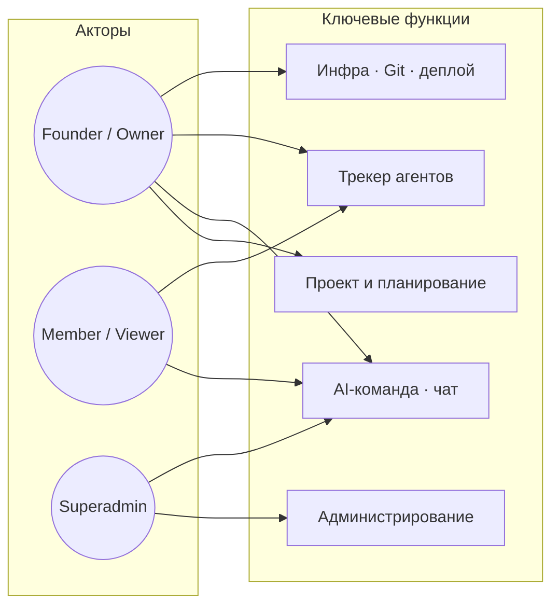

| Функция | Founder | Member | Superadmin | Реализация в UI |
|---------|:-------:|:------:|:----------:|-----------------|
| Создать проект, выбрать стек | ✓ | — | ✓ | Portal → проекты |
| Product planning | ✓ | просмотр | ✓ | Planning |
| Запуск AI-команды, stream прогона | ✓ | ✓ | ✓ | AI-team |
| Copilot / разовый ReAct | ✓ | ✓ | — | Agent graph chat |
| Трекер: эпики, задачи, dispatch | ✓ | ✓ | — | Задачи агентов |
| SSH targets, GitLab, контекст | ✓ | огранич. | ✓ | Настройки проекта |
| Промпты агентов, LLM, tools policy | — | — | ✓ | Superadmin |

### F3. Сквозные функциональные сценарии

```mermaid
flowchart TB
  classDef user fill:#bbdefb
  classDef func fill:#c8e6c9

  subgraph S1["Сценарий A — Новый продукт с нуля"]
    U1["Идея продукта"]:::user --> F1A["Planning: структура MVP"]:::func
    F1A --> F1B["Создание проекта + bootstrap"]
    F1B --> F1C["AI-команда full: SA → … → pm_summary"]
    F1C --> F1D["Артефакты: wiki · трекер · Git · деплой"]
  end

  subgraph S2["Сценарий B — Операционный вопрос"]
    U2["Сколько места / uptime / версия ОС?"]:::user --> F2A["Intake: direct · live_execution=false"]
    F2A --> F2B["DevOps ReAct: context + SSH"]
    F2B --> F2C["Ответ по фактам · без лишнего deploy"]
  end

  subgraph S3["Сценарий C — Задача в трекере"]
    U3["Карточка с assignee_role"]:::user --> F3A["Dispatch в очередь"]
    F3A --> F3B["Worker → ReAct /invoke"]
    F3B --> F3C["DoD: tool_verified"]
    F3C --> F3D["DONE / FAILED в UI"]
  end

  subgraph S4["Сценарий D — Изменение и релиз"]
    U4["Сделай сайт / задеплой / hotfix"]:::user --> F4A["Intake: full или direct + live_execution"]
    F4A --> F4B["Планы · execution_plan"]
    F4B --> F4C["Worker: SSH · Ansible · Git"]
    F4C --> F4D["QA GO/NO_GO · pm_summary"]
  end
```

### F4. Функции ↔ агенты (матрица ответственности)

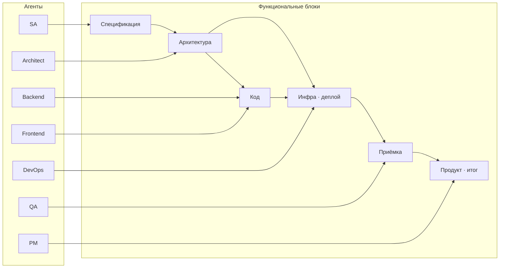

| Функциональный блок | Ведущий агент | Поддержка | Выход для пользователя |
|---------------------|---------------|-----------|-------------------------|
| ТЗ, traceability, задачи в трекере | SA | PM | Документы wiki, карточки трекера |
| Стек, границы системы | Architect | SA, PM | Архитектурный doc |
| API и backend | Backend | Architect, DevOps | План + коммиты |
| UI и frontend | Frontend | Architect | План + коммиты + browser smoke |
| CI/CD, серверы, K8s | DevOps | Architect | execution_tasks, деплой |
| Проверка релиза | QA | DevOps | GO / NO_GO |
| Отчёт стейкхолдеру | PM | все шаги | pm_summary |

### F5. Потоки данных по функциям (упрощённо)

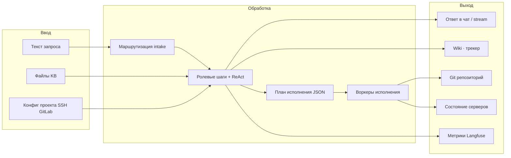

### F6. Границы функций: что внутри / что снаружи

| Внутри платформы | Снаружи (ответственность пользователя) |
|------------------|----------------------------------------|
| Оркестрация агентов, LLM, DoD, трекер | Бизнес-решения, приоритеты продукта |
| Вызов SSH/K8s/Ansible через adapter | Сами серверы, сеть, firewall, kubeconfig |
| GitLab provision, clone, commit | Содержимое prod GitLab, code review людьми |
| Хранение wiki, KB, runs в Postgres | Юридическое соответствие данных в облаке пользователя |
| Product planning как черновик плана | Утверждение scope и бюджета |

---

## Верхнеуровневая схема (слои)

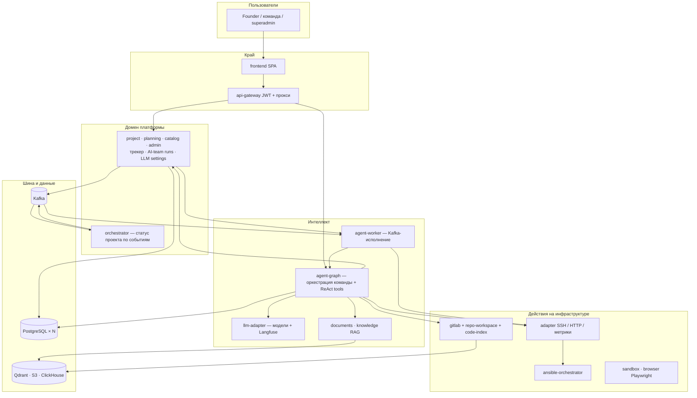

**Три входа для агентов:**

| Вход | Путь | Результат |
|------|------|-----------|
| **Чат / ReAct** | UI → gateway → `agent-graph` `/invoke` | Один прогон LangGraph + tools |
| **AI-команда** | UI → `agent-graph` `/orchestrate` ↔ `admin` runs | Многошаговый DAG ролей + execution tasks |
| **Трекер** | UI → `admin` dispatch → Kafka → `agent-worker` → `agent-graph` `/invoke` | Карточка задачи с проверкой tool-calling |

---

## Схема платформы (детально)

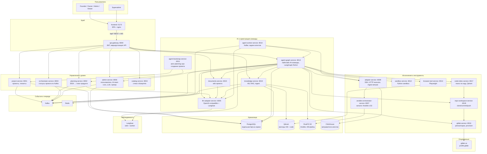

### Типовой сценарий: запрос в AI-команду

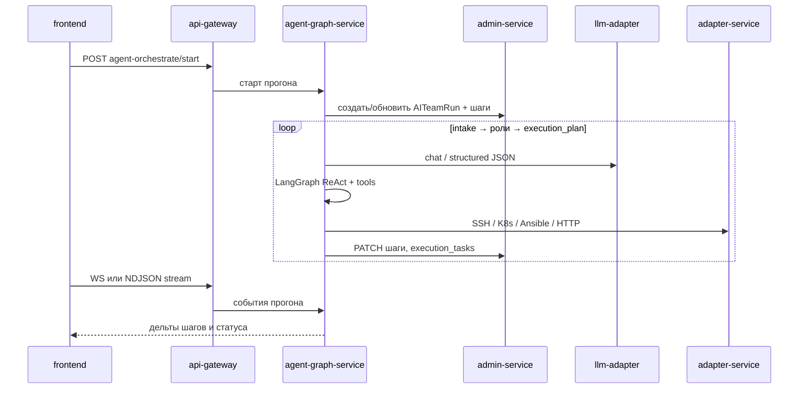

### Типовой сценарий: задача в трекере

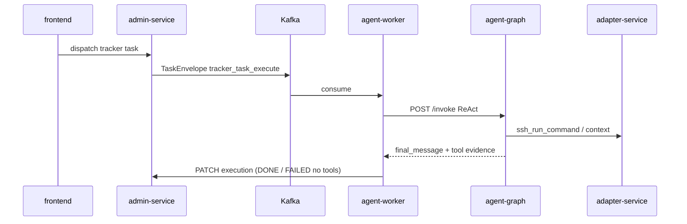

---

## Слои и принципы

| Слой | Назначение |
|------|------------|
| **Край** | Единая точка входа для браузера: статика UI + прокси `/api` на gateway (в т.ч. WebSocket). |
| **API Gateway** | Авторизация (JWT), tenant/project ACL, проксирование к внутренним сервисам. |
| **Домен** | Проекты, планирование, каталог, проекция админки, машина статусов проекта. |
| **AI-команда** | Многошаговый пайплайн ролей, LangGraph с tool calling, публикация задач на исполнение. |
| **Исполнение** | Безопасные адаптеры к SSH, Ansible, Git, браузеру, песочнице. |
| **Данные** | Изоляция: у каждого сервиса своя PostgreSQL; асинхронность через Kafka (outbox/inbox). |

---

## Компоненты

### Пользовательский интерфейс

| Компонент | Порт | Что делает |
|-----------|------|------------|
| **frontend** | 5173 → 80 | SPA (портал пользователя `#/portal`, superadmin `#/superadmin`). В prod nginx отдаёт статику и проксирует `/api` на gateway. |
| **api-gateway** | 8000 | Единый REST/WS API: проекты, planning, оркестрация AI-команды, adapter, admin, knowledge, browser logs и др. |

### Управление платформой и домен

| Компонент | Порт | Что делает |
|-----------|------|------------|
| **admin-service** | 8006 | Пользователи и роли, настройки LLM/агентов, **прогоны AI-команды** (runs/steps/execution_tasks), трекер (эпики/задачи), промпты ролей, внутренние API для agent-graph. |
| **project-service** | 8001 | Жизненный цикл проектов, тенанты, outbox событий в Kafka. |
| **planning-service** | 8002 | Прогон product planning (идея → структурированный план), вызов LLM. |
| **orchestrator-service** | 8003 | **Не путать с AI-orchestrate:** консьюмер Kafka, проекция **статуса проекта** (workflow платформы). |
| **catalog-service** | 8004 | Справочник стеков и blueprints для проектов. |
| **agent-bootstrap-service** | 8011 | Слушает события создания проекта → при необходимости автоматически запускает planning. |

### AI-команда и LLM

| Компонент | Порт | Что делает |
|-----------|------|------------|
| **agent-graph-service** | 8013 | Ядро **AI-команды**: intake (full/direct), шаги SA/PM/архитектор/планы/implementation/deploy/QA, `execution_plan` → задачи воркерам; LangGraph ReAct с platform tools; stream/WS событий. |
| **llm-adapter-service** | 8005 | Прокси к OpenAI-compatible API; настройки моделей из admin; трейсинг в Langfuse. |
| **agent-worker-service** | 8010 | Kafka `platform.agent.tasks`: **трекер** → ReAct через `agent-graph` `/invoke`; **AI-team execution** → SSH/K8s/Ansible через adapter. |
| **documents-service** | 8015 | Wiki/документы проекта (architecture, guides), контекст для агентов. |
| **knowledge-service** | 8019 | Базы знаний (платформа + проект): загрузка файлов, ingest (Kafka), чанки в Qdrant, `search_knowledge` для агентов. |

Роли в пайплайне (упрощённо): **intake** → маршрут full/direct → **SA** (формальные артефакты, трекер) → **PM / architect / devops / backend / frontend** → **execution_plan** → **implementation / deploy / QA / pm_summary**. В режиме `direct` часть шагов пропускается, ответ одной роли через ReAct.

### Исполнение и DevTools

| Компонент | Порт | Что делает |
|-----------|------|------------|
| **adapter-service** | 8008 | SSH targets, выполнение команд, подтверждения, HTTP executor, ingest метрик агента; связь с Ansible и ClickHouse. |
| **ansible-orchestrator-service** | 8007 | Marketplace Ansible-ролей (шаблоны в S3/RustFS), запуск плейбуков по запросу adapter/агентов. |
| **sandbox-service** | 8012 | Ограниченное выполнение Python для агентов. |
| **browser-tool-service** | 8014 | Playwright-сессии: навигация, снимки UI, smoke веб-приложений. |
| **gitlab-service** | 8016 | Provision групп/репозиториев, токены, интеграция с GitLab CE (опционально). |
| **repo-workspace-service** | 8018 | Локальные git-workspace: clone, read/write, commit, push. |
| **code-index-service** | 8017 | Индексация кода из workspace, семантический поиск (Qdrant). |

### Инфраструктура данных

| Компонент | Назначение |
|-----------|------------|
| **Kafka** | События домена (`platform.events`), задачи агентов (`platform.agent.tasks`), ingest knowledge. Паттерны outbox/inbox в сервисах. |
| **Redis** | Кэш/координация в agent-graph (например, последний run проекта). |
| **PostgreSQL** | Отдельный инстанс на сервис: `project`, `planning`, `admin`, `orchestrator`, `adapter`, `documents`, `knowledge`, `gitlab`, `repo-workspace`, `code-index`. |
| **Qdrant** | Векторные коллекции: чанки knowledge-base и code-index. |
| **RustFS (S3)** | Объектное хранилище: Ansible-шаблоны, файлы knowledge-base. |
| **ClickHouse** | Хранение метрик и логов с агентов на серверах пользователя. |

### Наблюдаемость и опции

| Компонент | Назначение |
|-----------|------------|
| **Langfuse** (web, worker, postgres, redis, clickhouse, minio) | Трейсы LLM-вызовов (llm-adapter, agent-graph). |
| **gitlab-ce** (profile `gitlab`) | Локальный GitLab CE для разработки; **gitlab-service** ходит в него по API. |

---

## Два вида «оркестрации»

| Термин | Сервис | Смысл |
|--------|--------|--------|
| **Project orchestration** | `orchestrator-service` | Статусы жизненного цикла **проекта** по событиям Kafka. |
| **AI-team orchestration** | `agent-graph-service` + `admin-service` | Прогон **запроса пользователя** через роли команды, задачи исполнения, stream в UI. |

---

## Потоки данных (кратко)

1. **Создание проекта** → `project-service` → Kafka → `agent-bootstrap` / `orchestrator` / проекция в `admin`.
2. **Product planning** → UI → gateway → `planning-service` → LLM → результат в planning DB.
3. **AI-команда** → gateway → `agent-graph` ↔ `admin` (runs) ↔ tools → `adapter` / Git / docs / knowledge → Kafka tasks → `agent-worker`.
4. **Knowledge upload** → gateway → `knowledge-service` → S3 + Kafka ingest → Qdrant; агенты ищут через tool `search_knowledge`.
5. **Код** → `gitlab-service` + `repo-workspace` + `code-index` (clone → правки → push → поиск).

---

## Репозиторий

| Путь | Содержимое |
|------|------------|
| `Platform/backend` | Все микросервисы (`services/*`), общие контракты, тесты. |
| `Platform/frontend` | TypeScript SPA, nginx для prod. |
| `Platform/docs` | Тематические заметки (GitLab, knowledge, code-index). |
| `schema.md` | Упрощённая схема только пайплайна AI-команды. |

---

## Локальный запуск

```bash
cd Platform
docker compose up -d --build
```

- UI: http://localhost:5173  
- API: http://localhost:8000  
- Подробнее: `Platform/README.md`

Для тяжёлого GitLab CE: `docker compose --profile gitlab up -d`.
