# Lambot Platform — Architecture Overview

The platform replaces an IT team for a founder: projects, product planning, an **AI team** (SA/PM/architect/DevOps/Backend/Frontend/QA roles), execution on the user’s infrastructure (SSH, K8s, Ansible), GitLab, wiki/documents, and knowledge bases.

Default deployment stack: `Platform/docker-compose.yml` (Python/FastAPI microservices + SPA + Kafka + several PostgreSQL instances).

---

## Architecture diagram: agents and components (for presentations)

Below are diagrams for slides and discussions with architects: the **virtual IT team (agents)**, the **orchestration engine**, **platform services**, and the **tool plane**.

### 1. Platform components and where agents sit

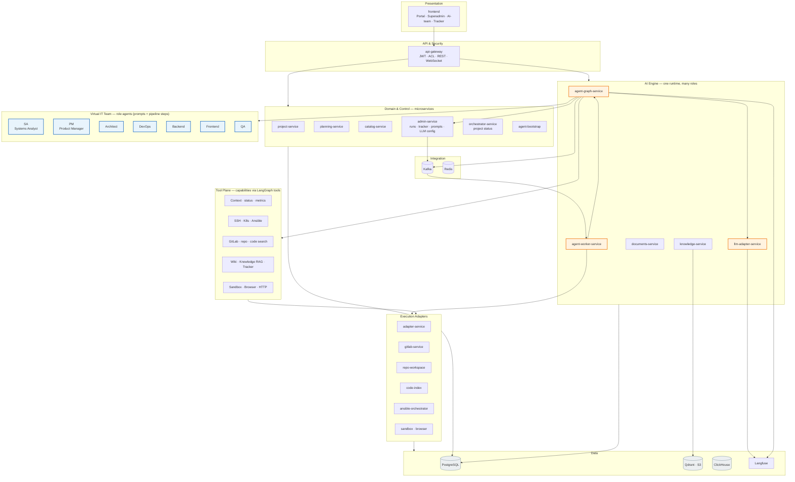

### 2. Multi-agent team: pipeline and modes

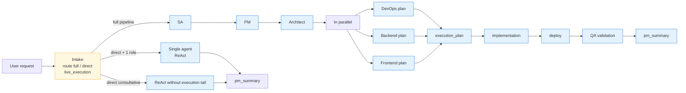

**Intake modes (LLM decision, not keyword heuristics):**

| Mode | Agents | Execution |
|------|--------|-----------|
| `full` | SA → PM → Architect → plans → execution | DAG + worker tasks |
| `direct` + `live_execution: false` | One role | ReAct, facts from the server / consultation |
| `direct` + `live_execution: true` | One role + execution tail | ReAct + execution_plan → deploy |

### 3. Agents: responsibility zones and tools

| Agent | Pipeline steps | Zone | Typical tools |
|-------|----------------|------|---------------|
| **SA** | `sa` | Spec, glossary, traceability, epics/tasks in the tracker | `upsert_project_document`, `tracker_create_*`, `tracker_list_items` |
| **PM** | `pm`, `pm_summary` | Scope, KPI, stakeholder summary | context, wiki, `get_project_status` |
| **Architect** | `architect` | Stack, HLD, service boundaries | wiki, context, peer consult |
| **DevOps** | `devops_plan`, `execution_plan`, `implementation`, `deploy` | CI/CD, SSH, Ansible, K8s | `ssh_run_command`, `ansible_run_template`, `kubernetes_query`, GitLab |
| **Backend** | `backend_plan` | API, services, DB | `search_codebase`, `repo_*`, context |
| **Frontend** | `frontend_plan` | UI, web, charts | `repo_write_commit_push`, `browser_session`, context |
| **QA** | `qa_validation` | Smoke, GO/NO_GO | `browser_session`, SSH, metrics |

On tool-enabled steps, all roles use **one LangGraph ReAct runtime** (`agent-graph`) and a **shared platform tools catalog** (`tool_policy` per project).

### 4. Agent runtime: ReAct + orchestrator

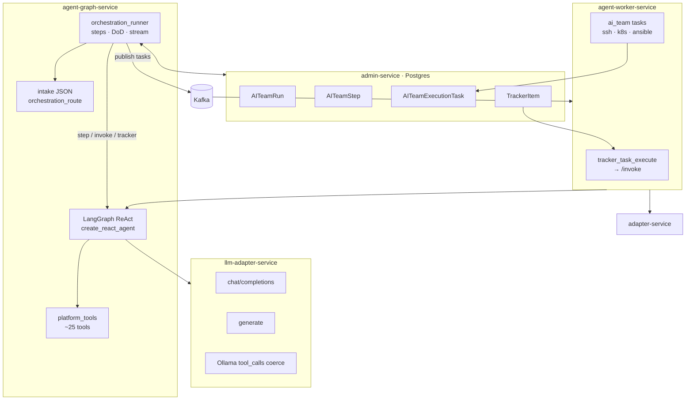

### 5. Three channels for interacting with agents

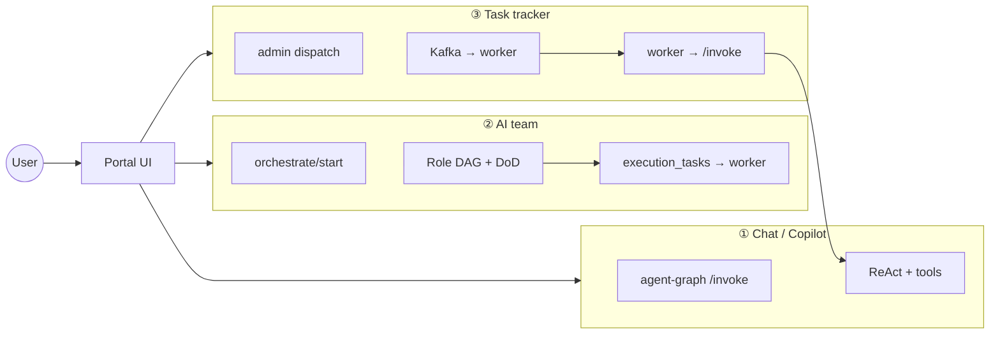

### 6. Tool plane (capability groups)

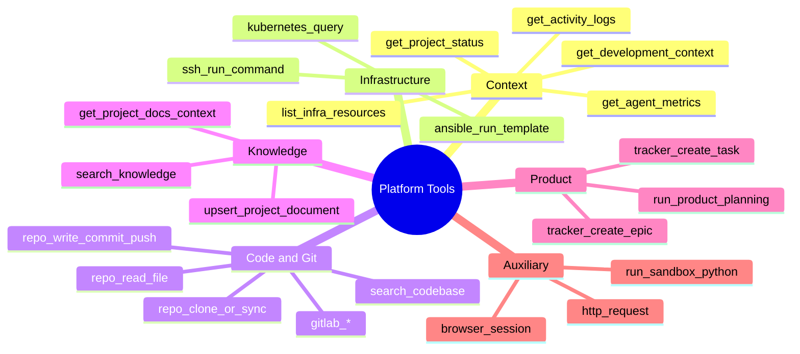

---

## How agents communicate with each other

Agents **do not maintain a persistent group chat** and **do not call each other as separate LangGraph instances**. Coordination goes through the **orchestrator** and **shared run state** (a “blackboard” pattern).

### Orchestration with shared state and failback control

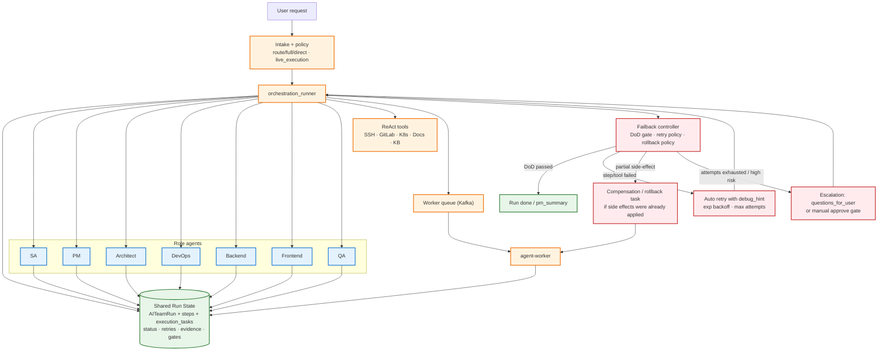

**How to read the diagram:**

- All agents read and write a single `Shared Run State` (blackboard): the source of truth for steps, artifacts, execution tasks, evidence, and retry counts.
- The orchestrator makes decisions only via policy + state (not local agent heuristics): start a step, transition, pause, finish.
- A failback loop is built into every step: `DoD gate` → retry → rollback/compensation → escalation to the user.
- Worker task execution is controlled via `execution_tasks` with statuses (`queued/running/done/failed`) and `tool_verified` confirmation.
- After retries are exhausted or for high-risk changes, a `manual approve gate` is enabled (user continue), then the run resumes from the same state.

### Ways of “communication”

| Method | When | How |
|--------|------|-----|
| **1. Accumulated context** | Every next pipeline step | The system prompt includes `### PM`, `### Architect`, … — outputs of all completed steps (`accumulated`) |
| **2. Peer queries** | A step returned `peer_queries` in JSON | The orchestrator synchronously asks a “colleague” (a separate LLM call with the peer role) and appends the answer to `summary_md` |
| **3. Parallel plans** | devops / backend / frontend at once | They start from **one snapshot** of `accumulated`; on retry failure — a `debug_hint` with outputs from peers that already finished |
| **4. Artifacts** | SA, wiki, tracker | Wiki documents, epics/tasks in the tracker with `assignee_role` — **asynchronous** handoff of work to another role |
| **5. Execution tasks** | After `execution_plan` | Shared task list in `AITeamRun.execution_tasks` — workers execute; all steps can see statuses |
| **6. ReAct tools** | Inside a single `/invoke` call | One agent may call `tracker_list_items`, `get_project_docs_context` — this is access to **data**, not a dialog with another agent |

**There is no:** direct message-passing between two ReAct graphs, shared memory between parallel steps in real time, or a separate “agent manager” LLM.

### Exchange flow in the AI team

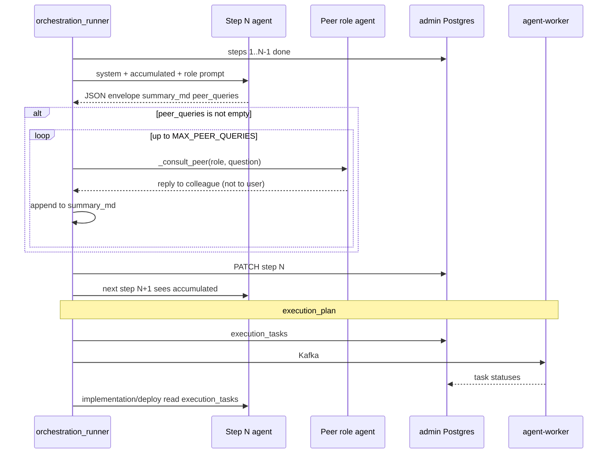

### Peer sync (detail)

In step JSON an agent may specify:

```json
"peer_queries": [{"role": "backend", "question": "Which endpoints already exist in the API?"}]
```

The orchestrator calls `_consult_peer`: a separate chat with the **backend role prompt**, the same **project context** and **accumulated steps**, and the instruction “answer a colleague, not the user.” The reply is inserted into a “Team sync (auto)” block in the step result.

Peer roles: `pm`, `architect`, `devops`, `backend`, `frontend` (not `qa` / `sa` in the `PRIMARY_ROLE_TO_STEP` mapping).

### Parallel plans

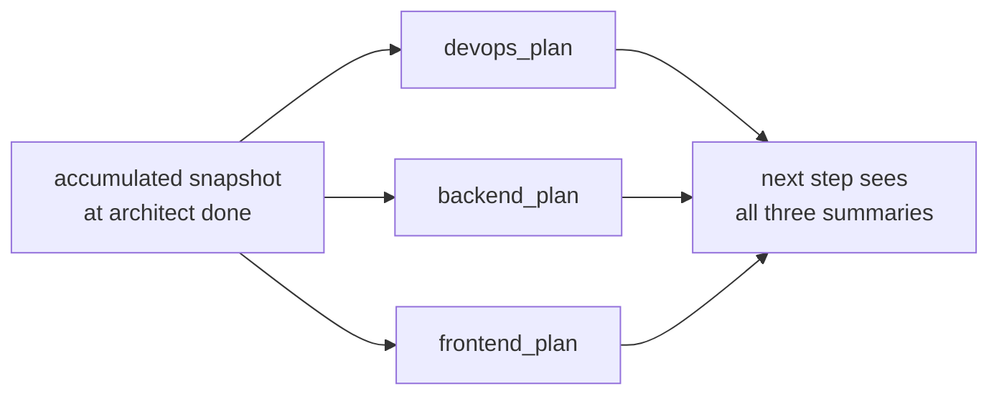

While plans run in parallel, they **do not learn about each other mid-flight** — only after write-back into `accumulated`.

### Tracker vs AI team

| Channel | Meaning |
|---------|---------|
| **AI team** | One run, one step stream, shared `run_id` |
| **Tracker** | SA (or the user) creates tasks with `assignee_role`; execution is a **separate** Kafka → worker → ReAct path; linkage to a run is only via `meta_json` / description, not live chat between agents |

### With the user (not between agents, but important)

- `questions_for_user` + `pipeline_continue: false` → pause the run; the user’s answer goes to `orchestrate/continue`.
- Tool-calling confirmation (“yes, execute”) → clears a gate; it is not a peer dialog.

---

## Functional platform diagram

Functional view: **what the platform does for the business**, who consumes each function, and **which end-to-end scenarios** connect the blocks (without tying to ports and service names).

### F1. Function map (top level)

```mermaid
flowchart TB
  classDef gov fill:#fce4ec,stroke:#c2185b
  classDef prod fill:#e8eaf6,stroke:#3949ab
  classDef eng fill:#e0f2f1,stroke:#00695c
  classDef ops fill:#fff3e0,stroke:#e65100
  classDef know fill:#f3e5f5,stroke:#6a1b9a

  LP["Lambot Platform<br/>virtual IT team for the founder"]

  LP --> GOV["Platform governance"]:::gov
  LP --> PROD["Product and project"]:::prod
  LP --> ENG["Engineering with AI agents"]:::eng
  LP --> OPS["Operations and infrastructure"]:::ops
  LP --> KNOW["Knowledge and artifacts"]:::know

  GOV --> GOV1["Users · roles · tenants"]
  GOV --> GOV2["LLM settings and agent prompts"]
  GOV --> GOV3["Tool policies · superadmin"]

  PROD --> PROD1["Project creation · stack catalog"]
  PROD --> PROD2["Product planning IDEA → PLAN"]
  PROD --> PROD3["Project lifecycle status"]

  ENG --> ENG1["Request intake routing"]
  ENG --> ENG2["Formal SA specification"]
  ENG --> ENG3["Architecture and role plans"]
  ENG --> ENG4["Code implementation in GitLab"]
  ENG --> ENG5["End-to-end AI-team run"]
  ENG --> ENG6["Interactive ReAct copilot"]

  OPS --> OPS1["Deploy and changes on servers"]
  OPS --> OPS2["SSH / K8s diagnostics"]
  OPS --> OPS3["Ansible marketplace"]
  OPS --> OPS4["Agent metrics and logs"]
  OPS --> OPS5["Tracker task enqueue and execution"]

  KNOW --> KNOW1["Project wiki"]
  KNOW --> KNOW2["Knowledge base RAG"]
  KNOW --> KNOW3["Epic and task tracker"]
  KNOW --> KNOW4["Codebase search"]
```

### F2. Actors and functions

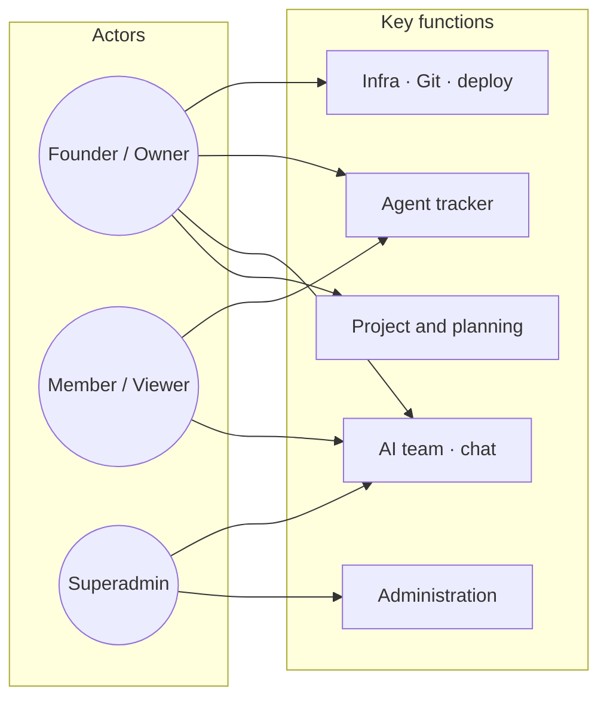

| Function | Founder | Member | Superadmin | UI implementation |
|----------|:-------:|:------:|:----------:|-------------------|
| Create project, choose stack | ✓ | — | ✓ | Portal → projects |
| Product planning | ✓ | view | ✓ | Planning |
| Start AI team, stream the run | ✓ | ✓ | ✓ | AI-team |
| Copilot / one-shot ReAct | ✓ | ✓ | — | Agent graph chat |
| Tracker: epics, tasks, dispatch | ✓ | ✓ | — | Agent tasks |
| SSH targets, GitLab, context | ✓ | limited | ✓ | Project settings |
| Agent prompts, LLM, tools policy | — | — | ✓ | Superadmin |

### F3. End-to-end functional scenarios

```mermaid
flowchart TB
  classDef user fill:#bbdefb
  classDef func fill:#c8e6c9

  subgraph S1["Scenario A — New product from scratch"]
    U1["Product idea"]:::user --> F1A["Planning: MVP structure"]:::func
    F1A --> F1B["Project creation + bootstrap"]
    F1B --> F1C["AI team full: SA → … → pm_summary"]
    F1C --> F1D["Artifacts: wiki · tracker · Git · deploy"]
  end

  subgraph S2["Scenario B — Operational question"]
    U2["How much disk / uptime / OS version?"]:::user --> F2A["Intake: direct · live_execution=false"]
    F2A --> F2B["DevOps ReAct: context + SSH"]
    F2B --> F2C["Fact-based answer · no extra deploy"]
  end

  subgraph S3["Scenario C — Tracker task"]
    U3["Card with assignee_role"]:::user --> F3A["Dispatch to queue"]
    F3A --> F3B["Worker → ReAct /invoke"]
    F3B --> F3C["DoD: tool_verified"]
    F3C --> F3D["DONE / FAILED in UI"]
  end

  subgraph S4["Scenario D — Change and release"]
    U4["Build the site / deploy / hotfix"]:::user --> F4A["Intake: full or direct + live_execution"]
    F4A --> F4B["Plans · execution_plan"]
    F4B --> F4C["Worker: SSH · Ansible · Git"]
    F4C --> F4D["QA GO/NO_GO · pm_summary"]
  end
```

### F4. Functions ↔ agents (responsibility matrix)

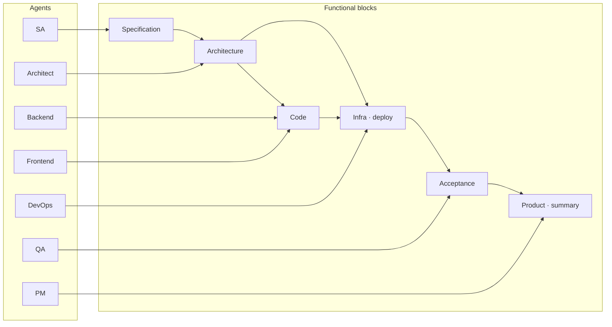

| Functional block | Lead agent | Support | User-facing output |
|------------------|------------|---------|--------------------|
| Spec, traceability, tracker tasks | SA | PM | Wiki documents, tracker cards |
| Stack, system boundaries | Architect | SA, PM | Architecture doc |
| API and backend | Backend | Architect, DevOps | Plan + commits |
| UI and frontend | Frontend | Architect | Plan + commits + browser smoke |
| CI/CD, servers, K8s | DevOps | Architect | execution_tasks, deploy |
| Release verification | QA | DevOps | GO / NO_GO |
| Stakeholder report | PM | all steps | pm_summary |

### F5. Data flows by function (simplified)

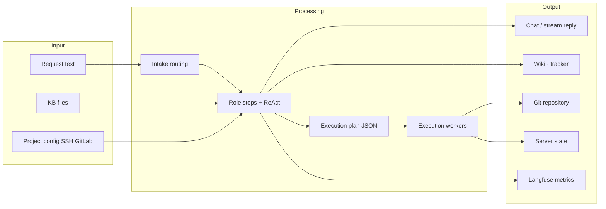

### F6. Function boundaries: inside / outside

| Inside the platform | Outside (user responsibility) |
|---------------------|-------------------------------|
| Agent orchestration, LLM, DoD, tracker | Business decisions, product priorities |
| SSH/K8s/Ansible calls via adapter | The servers themselves, network, firewall, kubeconfig |
| GitLab provision, clone, commit | Prod GitLab contents, human code review |
| Wiki, KB, runs storage in Postgres | Legal compliance for data in the user’s cloud |
| Product planning as a draft plan | Approving scope and budget |

---

## High-level diagram (layers)

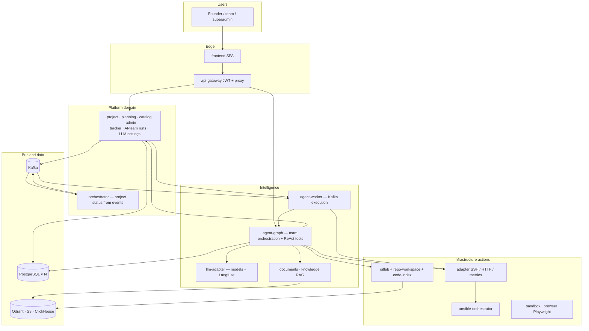

**Three entry points for agents:**

| Entry | Path | Result |
|-------|------|--------|
| **Chat / ReAct** | UI → gateway → `agent-graph` `/invoke` | One LangGraph run + tools |
| **AI team** | UI → `agent-graph` `/orchestrate` ↔ `admin` runs | Multi-step role DAG + execution tasks |
| **Tracker** | UI → `admin` dispatch → Kafka → `agent-worker` → `agent-graph` `/invoke` | Task card with tool-calling verification |

---

## Platform diagram (detailed)

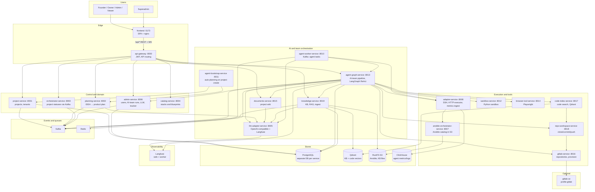

### Typical scenario: request to the AI team

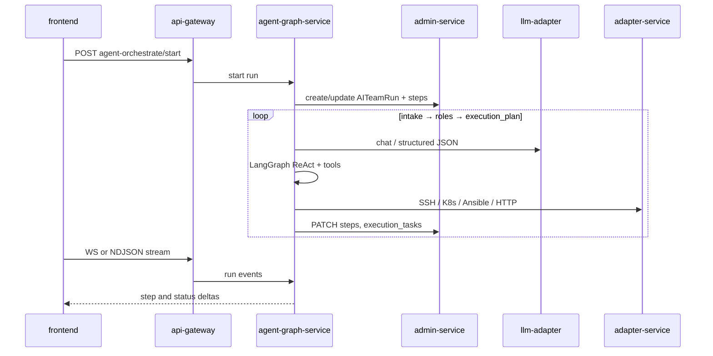

### Typical scenario: tracker task


---

## Layers and principles

| Layer | Purpose |
|-------|---------|
| **Edge** | Single browser entry point: UI static assets + `/api` proxy to the gateway (including WebSocket). |
| **API Gateway** | Auth (JWT), tenant/project ACL, proxying to internal services. |
| **Domain** | Projects, planning, catalog, admin projection, project status machine. |
| **AI team** | Multi-step role pipeline, LangGraph with tool calling, publishing execution tasks. |
| **Execution** | Safe adapters to SSH, Ansible, Git, browser, sandbox. |
| **Data** | Isolation: each service has its own PostgreSQL; async via Kafka (outbox/inbox). |

---

## Components

### User interface

| Component | Port | What it does |
|-----------|------|--------------|
| **frontend** | 5173 → 80 | SPA (user portal `#/portal`, superadmin `#/superadmin`). In prod, nginx serves static assets and proxies `/api` to the gateway. |
| **api-gateway** | 8000 | Unified REST/WS API: projects, planning, AI-team orchestration, adapter, admin, knowledge, browser logs, etc. |

### Platform control and domain

| Component | Port | What it does |
|-----------|------|--------------|
| **admin-service** | 8006 | Users and roles, LLM/agent settings, **AI-team runs** (runs/steps/execution_tasks), tracker (epics/tasks), role prompts, internal APIs for agent-graph. |
| **project-service** | 8001 | Project lifecycle, tenants, Kafka event outbox. |
| **planning-service** | 8002 | Product planning run (idea → structured plan), LLM calls. |
| **orchestrator-service** | 8003 | **Do not confuse with AI-orchestrate:** Kafka consumer, projection of **project status** (platform workflow). |
| **catalog-service** | 8004 | Stack and blueprint catalog for projects. |
| **agent-bootstrap-service** | 8011 | Listens for project-created events → starts planning automatically when needed. |

### AI team and LLM

| Component | Port | What it does |
|-----------|------|--------------|
| **agent-graph-service** | 8013 | **AI-team** core: intake (full/direct), SA/PM/architect/plans/implementation/deploy/QA steps, `execution_plan` → worker tasks; LangGraph ReAct with platform tools; event stream/WS. |
| **llm-adapter-service** | 8005 | Proxy to OpenAI-compatible APIs; model settings from admin; Langfuse tracing. |
| **agent-worker-service** | 8010 | Kafka `platform.agent.tasks`: **tracker** → ReAct via `agent-graph` `/invoke`; **AI-team execution** → SSH/K8s/Ansible via adapter. |
| **documents-service** | 8015 | Project wiki/documents (architecture, guides), context for agents. |
| **knowledge-service** | 8019 | Knowledge bases (platform + project): file upload, ingest (Kafka), chunks in Qdrant, `search_knowledge` for agents. |

Pipeline roles (simplified): **intake** → full/direct route → **SA** (formal artifacts, tracker) → **PM / architect / devops / backend / frontend** → **execution_plan** → **implementation / deploy / QA / pm_summary**. In `direct` mode some steps are skipped; one role answers via ReAct.

### Execution and DevTools

| Component | Port | What it does |
|-----------|------|--------------|
| **adapter-service** | 8008 | SSH targets, command execution, confirmations, HTTP executor, agent metrics ingest; links to Ansible and ClickHouse. |
| **ansible-orchestrator-service** | 8007 | Ansible role marketplace (templates in S3/RustFS), playbook runs on request from adapter/agents. |
| **sandbox-service** | 8012 | Restricted Python execution for agents. |
| **browser-tool-service** | 8014 | Playwright sessions: navigation, UI snapshots, web app smoke. |
| **gitlab-service** | 8016 | Group/repo provision, tokens, GitLab CE integration (optional). |
| **repo-workspace-service** | 8018 | Local git workspaces: clone, read/write, commit, push. |
| **code-index-service** | 8017 | Code indexing from workspace, semantic search (Qdrant). |

### Data infrastructure

| Component | Purpose |
|-----------|---------|
| **Kafka** | Domain events (`platform.events`), agent tasks (`platform.agent.tasks`), knowledge ingest. Outbox/inbox patterns in services. |
| **Redis** | Cache/coordination in agent-graph (e.g. last project run). |
| **PostgreSQL** | Separate instance per service: `project`, `planning`, `admin`, `orchestrator`, `adapter`, `documents`, `knowledge`, `gitlab`, `repo-workspace`, `code-index`. |
| **Qdrant** | Vector collections: knowledge-base and code-index chunks. |
| **RustFS (S3)** | Object storage: Ansible templates, knowledge-base files. |
| **ClickHouse** | Metrics and logs from agents on the user’s servers. |

### Observability and options

| Component | Purpose |
|-----------|---------|
| **Langfuse** (web, worker, postgres, redis, clickhouse, minio) | LLM call traces (llm-adapter, agent-graph). |
| **gitlab-ce** (profile `gitlab`) | Local GitLab CE for development; **gitlab-service** talks to it via API. |

---

## Two kinds of “orchestration”

| Term | Service | Meaning |
|------|---------|---------|
| **Project orchestration** | `orchestrator-service` | **Project** lifecycle statuses from Kafka events. |
| **AI-team orchestration** | `agent-graph-service` + `admin-service` | Running a **user request** through team roles, execution tasks, UI stream. |

---

## Data flows (brief)

1. **Project creation** → `project-service` → Kafka → `agent-bootstrap` / `orchestrator` / projection into `admin`.
2. **Product planning** → UI → gateway → `planning-service` → LLM → result in planning DB.
3. **AI team** → gateway → `agent-graph` ↔ `admin` (runs) ↔ tools → `adapter` / Git / docs / knowledge → Kafka tasks → `agent-worker`.
4. **Knowledge upload** → gateway → `knowledge-service` → S3 + Kafka ingest → Qdrant; agents search via the `search_knowledge` tool.
5. **Code** → `gitlab-service` + `repo-workspace` + `code-index` (clone → edits → push → search).

---

## Repository

| Path | Contents |
|------|----------|
| `Platform/backend` | All microservices (`services/*`), shared contracts, tests. |
| `Platform/frontend` | TypeScript SPA, nginx for prod. |
| `Platform/docs` | Topic notes (GitLab, knowledge, code-index). |
| `schema.md` | Simplified diagram of the AI-team pipeline only. |

---

## Local run

```bash
cd Platform
docker compose up -d --build
```

- UI: http://localhost:5173  
- API: http://localhost:8000  
- Details: `Platform/README.md`

For heavy GitLab CE: `docker compose --profile gitlab up -d`.
