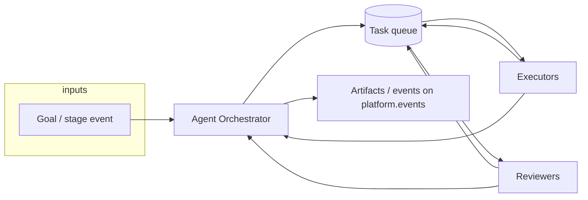

# Lambot platform AI agents

This layer defines **multi-agent execution** (task planning, executors, reviewers). It is logically separate from **`orchestrator-service`** in the backend: that service already drives the **project status pipeline** and Kafka events (`platform.events`). The AI orchestrator works **inside stages** (e.g. planning, codegen, infra hints) and exchanges **separate agent commands/results**.

## Roles

| Role | Purpose |
|------|---------|
| **Agent Orchestrator** | Splits a goal into a task DAG, assigns executors/reviewers, aggregates results, retries, escalates to a human. |
| **Executor** | One atomic task: LLM call + tools (API gateway, Ansible catalog, git, sandbox terminal). Writes artifact and status. |
| **Reviewer** | Rubric check: security, requirements fit, style, tests. Verdict: `approve` / `reject` + comments; on `reject` the orchestrator may reassign the task to an executor. |

## Data flow (logical)



1. The orchestrator receives **stage work** (from planning, human-in-the-loop, or your `EventEnvelope`).
2. It creates **tasks** of type `execute` or `review`, with dependencies and an idempotent `task_id`.
3. Executors take only `execute`; reviewers take `review` (often after a specific `execute` in the DAG).
4. Results are aggregated; on success the orchestrator emits into the shared bus (e.g. `codegen.completed` or a custom `agent.batch.completed`).

## Separation from Orchestrator Service

- **`orchestrator-service` (backend)** — project status projection, reaction to `PROJECT_STATUS_CHANGED`, transitions `PLAN_READY` → `INFRA_IN_PROGRESS`, etc.
- **Agent Orchestrator (this repo / separate process)** — **micro-orchestration inside a stage**: multiple LLM calls, chains, reviews, retries. It does not replace the project state machine; it **feeds it** with ready events.

This keeps “platform orchestrator” and “agent orchestrator” from mixing.

## Transport (recommendation)

| Option | Pros | Cons |
|--------|------|------|
| **Kafka topics** separate from `platform.events` | Scale, replay, Kafka already in compose | More topics and schemas |
| **Redis Streams / BullMQ** | Simple queue, retry | Another component |
| **PostgreSQL queue** (like outbox/inbox) | Consistency with DB | DB load |

Practical start: topics **`platform.agent.tasks`** and **`platform.agent.results`** (see `backend/shared/kafka.py`) — implemented in **`agent-worker-service`**. Contracts: `backend/shared/contracts/agent_task.py`.

## Policies

- **Idempotency**: `task_id` + `idempotency_key` in the task body; executor must not duplicate side effects.
- **Timeouts and limits**: per task and for the whole DAG; on timeout — `PIPELINE_FAILED` or partial result + escalation.
- **Secrets**: only via gateway / vault; agents must not keep keys in prompts.
- **Reviewer required** for merges into “dangerous” actions (deploy, infra changes).

## Directory layout

```
ai-agents/
  README.md           — this document
  contracts/task.py   — Pydantic TaskEnvelope / TaskResult (depends on pydantic)
  # later when implemented:
  # orchestrator/     — orchestrator process (DAG, retry)
  # workers/executor/
  # workers/reviewer/
```

Import for a prototype: `PYTHONPATH=ai-agents python -c "from contracts.task import TaskEnvelope, TaskType"`.

## Worker implementation (options)

- **Kafka consumer groups**: `agent-executors` / `agent-reviewers` read one task topic filtered by `task_type` (or two topics).
- **One binary**: orchestrator publishes to the queue; separate executor and reviewer deploys with different `KAFKA_GROUP_ID` or Redis consumer names.
- **LLM wiring**: call only the existing **`llm-adapter-service`** so keys and limits stay centralized.

Next step: move `contracts/task.py` into `backend/shared/contracts/agent_tasks.py`, add topics in compose, and a **dry-run** executor that only logs `TaskEnvelope`.

## Live agents demo (portal)

After **GitLab** is set up on the project (Ansible → resource `GitLab agent (group and token)` with PAT), in the UI: **Infrastructure → “Agents demo (GitLab)”**. The adapter calls the LLM as PM / architect / backend / devops and creates a GitLab group repository with `app.py`, `requirements.txt`, `.gitlab-ci.yml`. Open **Pipelines** in GitLab (Runner required). Endpoint: `POST /api/v1/projects/{id}/agent-demo/run`.

### Platform workflow bootstrap (AI)

**`agent-bootstrap-service`** listens to `platform.events`. On **`project.created`** (if `AGENT_BOOTSTRAP_AUTO_PLANNING=1`) it calls **planning** for a project in **IDEA** → then the existing **orchestrator** runs (PLAN_READY → INFRA_IN_PROGRESS). Manual retry: **Planning (bootstrap)** in the UI or `POST .../agents/bootstrap-planning`.

### Sandbox

**`sandbox-service`** runs Python via `python -c` in a temp directory with a timeout. From the portal: **Infrastructure → sandbox** or `POST .../sandbox/python`. The token is only passed through api-gateway (internal `X-Sandbox-Token`). This is not full OS isolation — for production use separate jobs/containers.

### LangGraph + tool calling

**`agent-graph-service`** (port 8013) builds a ReAct agent via **`langgraph.prebuilt.create_react_agent`** and registered tools (`langchain_core.tools`). Currently available: **development-context**, **project status**, **infra resources**, **run_sandbox_python**. LLM config matches **admin / llm-adapter** (including the coding model). Extend by editing `services/agent_graph_service/platform_tools.py` (new `@tool` + add to `build_platform_tools`). API: `POST /api/v1/projects/{id}/agent-graph/invoke` with body `{"message":"..."}` (via gateway).
