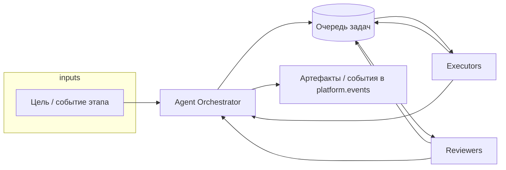

# AI-агенты платформы Lambot

Здесь задаётся **слой мультиагентного исполнения** (планирование задач, исполнители, проверяющие). Он логически отделён от **`orchestrator-service`** в backend: тот сервис уже ведёт **конвейер статусов проекта** и события Kafka (`platform.events`). AI-оркестратор работает **внутри этапов** (например, planning, codegen, infra-подсказки) и обменивается **отдельными командами/результатами агентов**.

## Роли

| Роль | Назначение |
|------|------------|
| **Agent Orchestrator** | Разбивает цель на DAG задач, назначает исполнителям/ревьюерам, собирает результаты, ретраи, эскалация человеку. |
| **Executor** | Одна атомарная задача: вызов LLM + инструменты (API gateway, Ansible catalog, git, терминал в песочнице). Пишет артефакт и статус. |
| **Reviewer** | Проверка по рубрике: безопасность, соответствие ТЗ, стиль, тесты. Вердикт: `approve` / `reject` + комментарии; при `reject` оркестратор может переотдать задачу исполнителю. |

## Поток данных (логический)



1. На вход оркестратору приходит **работа этапа** (из planning, из human-in-the-loop или из вашего `EventEnvelope`).
2. Оркестратор создаёт **задачи** с типом `execute` или `review`, зависимостями и идемпотентным `task_id`.
3. Исполнители забирают только `execute`, ревьюеры — `review` (часто после конкретного `execute` в DAG).
4. Результаты агрегируются; при успехе оркестратор эмитит событие в общий контур (например, `codegen.completed` или кастомный `agent.batch.completed`).

## Разделение с существующим Orchestrator Service

- **`orchestrator-service` (backend)** — проекция статусов проекта, реакция на `PROJECT_STATUS_CHANGED`, переходы `PLAN_READY` → `INFRA_IN_PROGRESS` и т.д.
- **Agent Orchestrator (этот репозиторий / отдельный процесс)** — **микро-оркестрация внутри этапа**: несколько LLM-вызовов, цепочки, ревью, повторы. Не подменяет state machine проекта, а **кормит её** готовыми событиями.

Так не смешиваются «оркестратор платформы» и «оркестратор агентов».

## Транспорт (рекомендация)

| Вариант | Плюсы | Минусы |
|---------|--------|--------|
| **Kafka topics** отдельно от `platform.events` | Масштаб, replay, уже есть Kafka в compose | Больше топиков и схем |
| **Redis Streams / BullMQ** | Простая очередь, retry | Ещё один компонент |
| **PostgreSQL queue** (как outbox/inbox) | Консистентность с БД | Нагрузка на БД |

Практичный старт: топики **`platform.agent.tasks`** и **`platform.agent.results`** (см. `backend/shared/kafka.py`) — реализовано в **`agent-worker-service`**. Контракты: `backend/shared/contracts/agent_task.py`.

## Политики

- **Идемпотентность**: `task_id` + `idempotency_key` в теле задачи; исполнитель не дублирует побочные эффекты.
- **Таймауты и лимиты**: на задачу и на весь DAG; при таймауте — `PIPELINE_FAILED` или частичный результат + эскалация.
- **Секреты**: только через gateway / vault; агенты не хранят ключи в промптах.
- **Reviewer обязателен** для merge в «опасные» действия (деплой, изменение инфраструктуры).

## Структура каталога

```
ai-agents/
  README.md           — этот документ
  contracts/task.py   — Pydantic-модели TaskEnvelope / TaskResult (зависимость: pydantic)
  # далее при реализации:
  # orchestrator/     — процесс оркестратора (DAG, retry)
  # workers/executor/
  # workers/reviewer/
```

Импорт моделей для прототипа: `PYTHONPATH=ai-agents python -c "from contracts.task import TaskEnvelope, TaskType"`.

## Реализация воркеров (на выбор)

- **Kafka consumer groups**: `agent-executors` / `agent-reviewers` читают один топик задач с фильтром по `task_type` (или два топика).
- **Один бинарник**: оркестратор публикует в очередь; отдельные деплои executor и reviewer с разными `KAFKA_GROUP_ID` или Redis consumer name.
- **Связка с LLM**: вызовы только через существующий **`llm-adapter-service`**, чтобы не плодить ключи и лимиты.

Следующий шаг: перенести `contracts/task.py` в `backend/shared/contracts/agent_tasks.py`, добавить топики в compose и **dry-run** executor, который только логирует `TaskEnvelope`.

## Демо «агенты вживую» (портал)

После **GitLab** в проекте (Ansible → ресурс `GitLab агент (группа и токен)` с PAT) в UI: **Инфраструктура → «Демо агентов (GitLab)»**. Adapter вызывает LLM с ролями PM / architect / backend / devops и создаёт в группе GitLab репозиторий с `app.py`, `requirements.txt`, `.gitlab-ci.yml`. Откройте **Pipelines** в GitLab (нужен Runner). Эндпоинт: `POST /api/v1/projects/{id}/agent-demo/run`.

### Запуск воркфлоу платформы (ИИ bootstrap)

Сервис **`agent-bootstrap-service`** слушает `platform.events`. При событии **`project.created`** (если `AGENT_BOOTSTRAP_AUTO_PLANNING=1`) вызывается **planning** для проекта в статусе **IDEA** → дальше срабатывает существующий **orchestrator** (PLAN_READY → INFRA_IN_PROGRESS). Повтор вручную: **Planning (bootstrap)** в UI или `POST .../agents/bootstrap-planning`.

### Песочница (sandbox)

**`sandbox-service`** выполняет Python-код через `python -c` во временном каталоге с таймаутом. Вызов с портала: **Инфраструктура → песочница** или `POST .../sandbox/python`. Токен передаётся только через api-gateway (внутренний `X-Sandbox-Token`). Это не полная изоляция ОС — для production используйте отдельные job/контейнеры.

### LangGraph + tool calling

Сервис **`agent-graph-service`** (порт 8013) строит ReAct-агента через **`langgraph.prebuilt.create_react_agent`** и зарегистрированные инструменты (`langchain_core.tools`). Сейчас доступны вызовы: **development-context**, **статус проекта**, **infra resources**, **run_sandbox_python**. Конфигурация LLM совпадает с **admin / llm-adapter** (в т.ч. модель coding). Расширение: правки в `services/agent_graph_service/platform_tools.py` (новые `@tool` + добавление в список `build_platform_tools`). API: `POST /api/v1/projects/{id}/agent-graph/invoke` с телом `{"message":"..."}` (через gateway).
